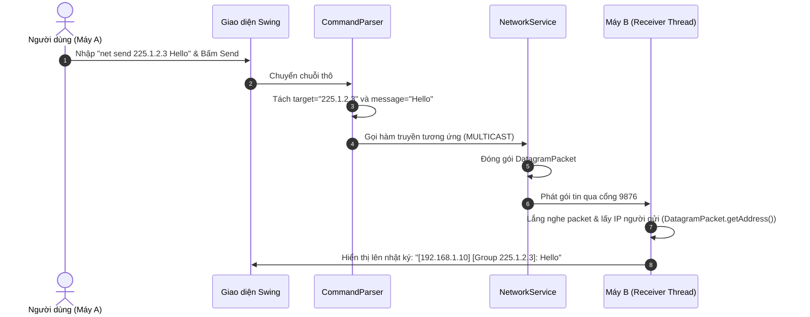

# 📘 PHASE 1: PHÂN TÍCH ĐỀ BÀI VÀ THIẾT KẾ Ý TƯỞNG
**Dự án**: Ứng dụng Net Send truyền tin nhắn qua mạng LAN (Java Multicast / UDP)  
**Mô hình kiến trúc**: Peer-to-Peer (Node-to-Node)

---

## 1. Giải thích đề bài đơn giản
Xây dựng một ứng dụng Java truyền tin nhắn nội bộ trong mạng LAN tương tự công cụ `net send` trên Windows.
- Người dùng gửi tin nhắn theo cú pháp: `net send {IP | group | *} message`
- Địa chỉ đích có thể là:
  - Một máy cụ thể thông qua **IP Unicast** (Ví dụ: `192.168.1.20`)
  - Một nhóm máy thông qua **Multicast Group IP** (Ví dụ: `225.1.2.3`)
  - Tất cả các máy trong mạng thông qua **Ký tự `*`** (Broadcast / Default Multicast Group)
- Máy nhận gói tin phải trích xuất và hiển thị: **[Địa chỉ IP máy gửi] + [Nội dung tin nhắn]**.
- Chương trình có giao diện đồ họa **GUI** trực quan.

---

## 2. Phân tách yêu cầu chức năng (Functional Requirements)

| Mã YC | Chức năng | Mô tả chi tiết |
| :--- | :--- | :--- |
| **F1** | **Nhập & Phân tích lệnh (Parser)** | Phân tích cú pháp `net send {target} {message}` hoặc đọc dữ liệu từ form GUI. |
| **F2** | **Phân loại chế độ gửi** | Tự động nhận diện `target`: Unicast IP, Multicast Group IP, hay `*`. |
| **F3** | **Truyền dữ liệu (Send)** | Đóng gói tin nhắn dạng UDP Datagram và phát đi theo phương thức tương ứng. |
| **F4** | **Lắng nghe mạng (Receive)** | Tiến trình chạy ngầm (Background Thread) liên tục chờ gói tin UDP/Multicast tới. |
| **F5** | **Trích xuất thông tin người gửi** | Bóc tách địa chỉ IP người gửi từ header của gói `DatagramPacket` thu được. |
| **F6** | **Giao diện người dùng (GUI)** | Màn hình hiển thị bảng điều khiển, nhật ký tin nhắn và khu vực gửi tin. |

---

## 3. Định nghĩa các khái niệm cốt lõi

- **Sender (Máy gửi)**: Đóng gói nội dung `message` và phát đi qua DatagramSocket / MulticastSocket.
- **Receiver (Máy nhận)**: Mở Socket lắng nghe Port quy ước, tiếp nhận và hiển thị gói tin lên GUI.
  > *Ghi chú*: Trong bài này, mỗi máy vừa làm Sender vừa làm Receiver (Node Ngang Hàng - Peer-to-Peer).
- **IP Unicast**: Địa chỉ IP riêng của từng máy trong dải mạng LAN (vd: `192.168.1.15`).
- **Group (Multicast IP)**: Địa chỉ IP Class D (`224.0.0.0` đến `239.255.255.255`). Các máy `joinGroup` này sẽ nhận được tin nhắn chung.
- ***** **(All / Broadcast)**: Ký hiệu tượng trưng cho gửi đến tất cả các máy trong mạng.
- **Message**: Chuỗi nội dung văn bản cần truyền đi.

---

## 4. Phân biệt Unicast, Multicast, Broadcast & Phân tích Ký hiệu `*`

### 4.1. Phân biệt 3 cơ chế mạng

| Cơ chế | Cú pháp | Đối tượng nhận | Giao thức Java Socket |
| :--- | :--- | :--- | :--- |
| **Unicast (1 - 1)** | `net send 192.168.1.20 Hello` | 1 máy duy nhất có IP tương ứng | `DatagramSocket` + `DatagramPacket` |
| **Multicast (1 - Nhóm)** | `net send 225.1.2.3 Hello Group` | Các máy đã `joinGroup` `225.1.2.3` | `MulticastSocket` (`joinGroup`) |
| **Broadcast (1 - Tất cả)**| `net send * Hello All` | Tất cả các máy mở port lắng nghe trong LAN | `DatagramSocket` (IP `255.255.255.255`) |

### 4.2. Phân tích ký hiệu `*` (Chỉ điểm quan trọng)
Ký hiệu `*` trong đề chưa ghi rõ cơ chế hạ tầng. Có 2 cách hiểu kĩ thuật:
1. **Cách 1 (Broadcast)**: Gửi gói UDP Broadcast đến địa chỉ `255.255.255.255` hoặc IP Broadcast của Subnet.
2. **Cách 2 (Default Multicast Group)**: Tất cả ứng dụng mặc định tự `joinGroup` vào 1 IP Multicast chung (vd: `230.0.0.1`). Khi gõ `*`, chương trình quy đổi `*` thành IP Multicast mặc định này.

---

## 5. Trả lời câu hỏi Kiến trúc quan trọng

### ❓ Có cần phân chia giao diện Server và Client không?
👉 **KHÔNG CẦN.** Đây là mô hình **Ngang hàng (Peer-to-Peer)**. Mỗi máy cài phần mềm này là một Node độc lập, sử dụng **cùng 1 Giao diện duy nhất** vừa gửi vừa nhận tin nhắn.

### ❓ Có cần làm chức năng Đăng nhập / Đăng ký không?
👉 **KHÔNG CẦN.** Hệ thống định danh người gửi dựa trên **Địa chỉ IP hạ tầng mạng** (`InetAddress.getLocalHost()`), đúng theo bản chất công cụ `net send` gốc.

---

## 6. Sơ đồ Kiến trúc & Luồng xử lý Dữ liệu

### 6.1. Sơ đồ Tổng thể Chương trình (Architecture Diagram)

```mermaid
graph TD
    subgraph Máy A (Peer Node 1)
        GUI_A[MainFrame GUI A] -->|1. Nhập net send| Parser_A[CommandParser]
        Parser_A -->|2. Phân loại| Net_A[NetworkService]
        Net_A -->|3. Gửi UDP| Socket_A[Datagram / Multicast Socket]
    end

    Socket_A -->|Unicast 1-1 / Multicast 1-Group / Broadcast 1-All| LAN((Mạng LAN))

    subgraph Máy B (Peer Node 2)
        LAN --> Receiver_B[ReceiverThread]
        Receiver_B -->|4. Trích xuất IP + Text| GUI_B[MainFrame GUI B]
    end
```

### 6.2. Sơ đồ Luồng (Flowchart Sequence)



---

## 7. Cấu trúc Package & Class dự kiến

```text
src/
 ├── app/
 │    └── Main.java                # Điểm khởi chạy ứng dụng
 ├── model/
 │    ├── TargetType.java          # Enum (UNICAST, MULTICAST, BROADCAST)
 │    └── ChatMessage.java         # Dữ liệu gói tin (senderIP, content, target, timestamp)
 ├── network/
 │    ├── NetworkService.java      # Quản lý gửi gói UDP Unicast, Multicast, Broadcast
 │    ├── ReceiverThread.java      # Tiến trình ngầm lắng nghe gói tin liên tục
 │    └── CommandParser.java       # Phân tích cú pháp chuỗi "net send ..."
 └── gui/
      └── MainFrame.java           # Giao diện điều khiển GUI (Swing)
```

---

## 8. Thiết kế Giao diện GUI Đầy đủ Chức năng

Giao diện được thiết kế gồm **4 Khu Vực Chức Năng**:

```text
┌─────────────────────────────────────────────────────────────────────────────┐
│ 🟢 KHU VỰC 1: THÔNG TIN MẠNG (System Info Bar)                             │
│ IP Local: 192.168.1.15  | Port Lắng nghe: 9876  | Multicast Group: 225.1.2.3   │
├─────────────────────────────────────────────────────────────────────────────┤
│ 🔵 KHU VỰC 2: NHẬT KÝ TIN NHẮN (Message History Log Window)                 │
│ ┌─────────────────────────────────────────────────────────────────────────┐ │
│ │ [17:05:12] [UNICAST]   Từ 192.168.1.20 : Xin chào riêng bạn!             │ │
│ │ [17:06:01] [MULTICAST] Từ 192.168.1.30 [Group 225.1.2.3]: Thông báo nhóm!│ │
│ │ [17:07:22] [BROADCAST] Từ 192.168.1.10 [*]: Thông báo toàn mạng LAN!     │ │
│ └─────────────────────────────────────────────────────────────────────────┘ │
├─────────────────────────────────────────────────────────────────────────────┤
│ 🟡 KHU VỰC 3: BỘ GỬI TIN NHẮN (Send & Mode Controller)                      │
│ Chế độ gửi: (•) Unicast (1 máy IP)   ( ) Multicast (Nhóm Group)   ( ) Broadcast (*)│
│                                                                             │
│ Địa chỉ Đích (Target): [ 192.168.1.20         ]                             │
│ Nội dung (Message):   [ Nhập tin nhắn ở đây... ] [ 🚀 GỬI (NET SEND)  ]   │
│                                                                             │
│ Hoặc nhập dạng lệnh thô: [ net send 225.1.2.3 Hello Group        ] [ GỬI ] │
├─────────────────────────────────────────────────────────────────────────────┤
│ 🔴 KHU VỰC 4: QUẢN LÝ MULTICAST GROUP & HƯỚNG DẪN                           │
│ IP Group: [ 225.1.2.3 ]  [ Tham gia (Join Group) ]  [ Rời nhóm (Leave) ]    │
│ Cú pháp mẫu: net send {IP | group | *} message                              │
└─────────────────────────────────────────────────────────────────────────────┘
```

---

## 9. Giải thích lý do cần từng Class / Component

- `MainFrame`: Tạo giao diện GUI trực quan 4 khu vực.
- `CommandParser`: Tách câu lệnh thô `net send {target} {message}` thành tham số dữ liệu chuẩn.
- `NetworkService`: Đóng vai trò Sender, xử lý tạo Socket và gửi gói tin theo chế độ tương ứng.
- `ReceiverThread`: Chạy ngầm liên tục để lắng nghe cổng UDP mà không gây đơ/lag giao diện GUI.
- `ChatMessage`: Chứa thông tin tin nhắn để chuyển đổi an toàn giữa Network Layer và GUI Layer.

---

## 10. Kiến thức Java Networking cần học trước khi Code

1. `java.net.InetAddress`: Chuyển đổi chuỗi IP thành đối tượng IP Java, kiểm tra IP Multicast.
2. `java.net.DatagramPacket`: Đóng gói mảng byte dữ liệu, địa chỉ đích và cổng nhận.
3. `java.net.DatagramSocket`: Tạo Socket gửi/nhận gói UDP Unicast và Broadcast.
4. `java.net.MulticastSocket`: Kế thừa `DatagramSocket`, cung cấp hàm `joinGroup()` & `leaveGroup()`.
5. Multi-threading (`Thread` / `Runnable`): Xử lý bất đồng bộ cho tiến trình lắng nghe.
6. `SwingUtilities.invokeLater()`: Cập nhật giao diện GUI an toàn từ Thread ngầm.

---

## 11. Ví dụ kịch bản chạy thực tế

Giả sử trong mạng LAN có 3 máy cùng mở ứng dụng ở cổng `9876`:
- **Máy A**: `192.168.1.10`
- **Máy B**: `192.168.1.20` (Đã Join nhóm `225.1.2.3`)
- **Máy C**: `192.168.1.30` (Chưa Join nhóm `225.1.2.3`)

1. **Unicast**: Máy A gửi `net send 192.168.1.20 Hello B`  
   👉 Chỉ Máy B hiển thị: `[192.168.1.10]: Hello B`.
2. **Multicast**: Máy A gửi `net send 225.1.2.3 Chat Nhom`  
   👉 Chỉ Máy B (đã join) hiển thị: `[192.168.1.10] [Group 225.1.2.3]: Chat Nhom`. Máy C không nhận được.
3. **Broadcast (`*`)**: Máy A gửi `net send * Thong Bao Chung`  
   👉 Cả Máy B và Máy C đều hiển thị: `[192.168.1.10] [*]: Thong Bao Chung`.

---

## 12. 10 Câu hỏi tự kiểm tra (Self-check Questions)

1. Mô hình kiến trúc chính của ứng dụng này là Client-Server hay Peer-to-Peer?
2. Cú pháp `net send` gồm những thành phần cơ bản nào?
3. Dải địa chỉ IP Multicast (Class D) nằm trong khoảng nào?
4. Nếu gửi tin nhắn tới IP Multicast mà máy nhận chưa `joinGroup`, gói tin có nhận được không?
5. Ký hiệu `*` đại diện cho phương thức gửi nào trong mạng LAN?
6. Tại sao tiến trình lắng nghe gói tin (`ReceiverThread`) phải chạy trên một Thread riêng biệt?
7. Địa chỉ IP của máy gửi được trích xuất từ đâu khi gói tin tới máy nhận?
8. Lớp nào trong thư viện `java.net` hỗ trợ tính năng Join/Leave nhóm Multicast?
9. Ứng dụng này sử dụng giao thức tầng Giao vận (Transport) nào: TCP hay UDP?
10. Tại sao ứng dụng không cần làm tính năng Đăng nhập / Đăng ký tài khoản?

---

## 13. Checklist kiến thức hoàn thành Phase 1
- [x] Hiểu rõ bài toán và yêu cầu chức năng.
- [x] Phân biệt rõ 3 cơ chế Unicast, Multicast và Broadcast.
- [x] Hiểu kiến trúc P2P (Node ngang hàng) và lý do không cần Server/Login.
- [x] Nắm rõ cấu trúc Package/Class và mô hình Phân tầng (Layered Architecture).
- [x] Nắm rõ thiết kế giao diện GUI 4 khu vực chức năng.
