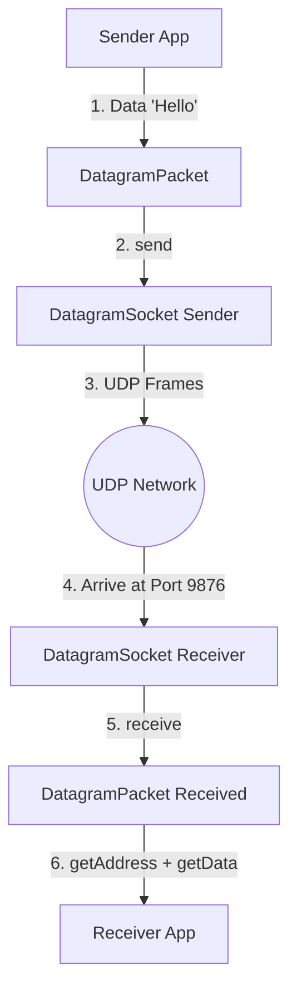
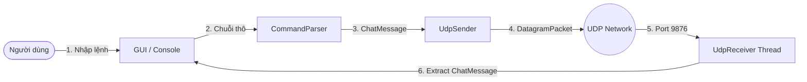

# 📗 PHASE 2: THIẾT KẾ KIẾN TRÚC VÀ NỀN TẢNG UDP NETWORKING IN JAVA

---

## 🎯 PHẦN A — HỌC UDP NETWORKING

### 1. UDP là gì?
- **UDP (User Datagram Protocol)** là giao thức truyền dữ liệu không hướng kết nối (Connectionless) nằm ở tầng Transport (Giao vận) trong mô hình TCP/IP.
- Khi gửi dữ liệu bằng UDP, máy gửi đóng gói dữ liệu thành các **Datagram** và phát đi ngay lập tức mà không cần thiết lập kết nối (bắt tay) trước với máy nhận.

### 2. UDP khác TCP như thế nào?

| Tiêu chí | TCP (Transmission Control Protocol) | UDP (User Datagram Protocol) |
| :--- | :--- | :--- |
| **Bản chất kết nối** | Hướng kết nối (Connection-oriented) | Không kết nối (Connectionless) |
| **Bắt tay 3 bước** | Có (3-way handshake) | Không có |
| **Độ tin cậy** | Đảm bảo 100% không mất gói, đúng thứ tự | Không đảm bảo (Có thể mất gói, sai thứ tự) |
| **Chế độ truyền** | Chỉ truyền **1 - 1 (Unicast)** | Truyền được **Unicast (1-1), Multicast (1-Nhóm), Broadcast (1-Tất cả)** |
| **Tốc độ & Chi phí** | Chậm hơn, chi phí xử lý cao hơn | Rất nhanh, nhẹ, overhead cực thấp |

### 3. Tại sao bài net send lại sử dụng UDP?
1. **Hỗ trợ Multicast và Broadcast**: Đề bài yêu cầu gửi đến nhóm máy (`group`) và tất cả các máy (`*`). Giao thức TCP **không thể** làm được việc này (TCP chỉ hỗ trợ 1 - 1).
2. **Tính chất tin nhắn tức thời**: Tin nhắn `net send` là dạng thông điệp ngắn, phát trực tiếp trong mạng LAN.

### 4. DatagramSocket là gì?
- **`DatagramSocket`** đại diện cho "cánh cổng Socket UDP" mở trên card mạng của hệ điều hành.
- Dùng để thực hiện hành động **gửi (`send()`)** và **nhận (`receive()`)** các gói `DatagramPacket`.

### 5. DatagramPacket là gì?
- **`DatagramPacket`** là "phong bì chứa dữ liệu mạng".
- Gói chứa: mảng byte nội dung (`byte[]`), độ dài (`length`), Địa chỉ IP (`InetAddress`) và Cổng (`Port`).

### 6. IP là gì?
- **IP (Internet Protocol Address)** là địa chỉ định danh duy nhất của từng thiết bị/máy tính trong mạng LAN (vd: `192.168.1.15`).

### 7. Port là gì?
- **Port (Số cổng)** là chỉ số định danh cho một ứng dụng/tiến trình đang chạy trên máy tính (vd: port `9876`).

### 8. Data được đưa vào DatagramPacket như thế nào?
- Chuỗi ký tự (String) ➔ Chuyển thành mảng `byte[]` UTF-8 ➔ Đưa vào khởi tạo `new DatagramPacket(bytes, bytes.length, destinationIP, destinationPort)`.

### 9. DatagramPacket được gửi qua mạng như thế nào?
- Sender gọi `socket.send(packet)`. OS bóc tách `DatagramPacket`, thêm UDP Header, IP Header và đẩy ra card mạng dưới dạng khung dữ liệu (Frame).

### 10. Receiver nhận packet như thế nào?
- Receiver khởi tạo `DatagramSocket(port)` và gọi `socket.receive(emptyPacket)`. Tiến trình sẽ chờ (blocking) cho đến khi card mạng nhận được gói UDP tại cổng đó.

### 11. Làm thế nào Receiver lấy message, IP sender, Port sender?
- **Message**: `new String(packet.getData(), 0, packet.getLength(), StandardCharsets.UTF_8)`
- **IP Sender**: `packet.getAddress().getHostAddress()`
- **Port Sender**: `packet.getPort()`

### 🖼 Sơ đồ luồng UDP tổng quan:



---

## 🏗 PHẦN B — XÂY DỰNG CẤU TRÚC PROJECT

Cấu trúc dự án Java chuẩn dành cho sinh viên (Sạch sẽ, Phân tầng rõ ràng, Dễ bảo vệ bài tập):

```text
NetSend/
 └── src/
      ├── model/
      │    └── ChatMessage.java        # Class dữ liệu chứa thông tin tin nhắn
      ├── parser/
      │    └── CommandParser.java      # Phân tích cú pháp câu lệnh "net send ..."
      ├── network/
      │    ├── UdpSender.java          # Xử lý phát gói tin UDP (Unicast / Broadcast)
      │    └── UdpReceiver.java        # Tiến trình ngầm lắng nghe gói tin UDP
      └── app/
           └── Main.java               # Điểm khởi chạy ứng dụng (Console Test Phase 2)
```

---

## 📋 PHẦN C — GIẢI THÍCH TỪNG PACKAGE / CLASS

| Class | Nhiệm vụ | Input | Output | Được gọi bởi |
| :--- | :--- | :--- | :--- | :--- |
| **`ChatMessage`** | Đóng gói dữ liệu tin nhắn | `destination`, `content`, `senderIp` | Đối tượng chứa thông tin tin nhắn | `CommandParser`, `UdpReceiver`, `GUI` |
| **`CommandParser`**| Tách cú pháp `net send {target} {message}` | Chuỗi thô do người dùng nhập | Đối tượng `ChatMessage` | `Main` / `GUI` |
| **`UdpSender`** | Đóng gói & gửi gói UDP qua mạng | `targetIP`, `port`, `messageContent` | Gói UDP truyền ra mạng | `Main` / `GUI` |
| **`UdpReceiver`** | Tiến trình ngầm lắng nghe cổng UDP | Cổng lắng nghe (`port`) | In tin nhắn ra màn hình/Cập nhật GUI | `Main` (Chạy trên Thread riêng) |
| **`Main`** | Điểm bắt đầu chương trình | Lệnh nhập từ bàn phím | Điều phối gửi/nhận | Hệ điều hành (JVM) |

---

## 💡 PHẦN D — TẠI SAO PHẢI CHIA CLASS?

### So sánh 2 cách viết code:

* **Cách 1: Nhồi tất cả vào 1 file `Main.java` (Monolithic)**
  - ❌ Code dài hàng trăm dòng, đống `if-else` lộn xộn.
  - ❌ Rất khó debug khi bị lỗi socket hay lỗi cú pháp.
  - ❌ Khi sang Phase 3 (Multicast) hoặc Phase 4 (GUI), bạn sẽ phải viết lại từ đầu vì code mạng bị dính chặt vào UI.

* **Cách 2: Phân chia cấu trúc Class theo Phân tầng (Modular Architecture)**
  - ✅ **Dễ đọc**: Tìm code mạng vào `network`, tìm code phân tích cú pháp vào `parser`.
  - ✅ **Dễ mở rộng**: Khi thêm Multicast chỉ cần viết thêm `MulticastManager.java` trong package `network`.
  - ✅ **Dễ làm GUI**: Sau này GUI chỉ việc gọi `CommandParser.parse()` và `UdpSender.send()`.
  - ✅ **Dễ vấn đáp**: Khi thầy cô hỏi "Đoạn nào xử lý gửi gói tin?", bạn chỉ cần mở file [UdpSender.java](file:///d:/Lap_Trinh_Mang/Lab6_Multicast/src/network/UdpSender.java).

---

## 🔄 PHẦN E — THIẾT KẾ LUỒNG ỨNG DỤNG



---

## 📊 PHẦN F — THIẾT KẾ LUỒNG DỮ LIỆU (DATA TRACING)

Kịch bản: Người dùng nhập `net send 192.168.1.10 Hello`

```text
1. [User Input] ─────> String: "net send 192.168.1.10 Hello"
                             │
2. [CommandParser] ──> Model Object ChatMessage:
                             ├─ destination = "192.168.1.10"
                             └─ content     = "Hello"
                             │
3. [UdpSender] ──────> String content "Hello" ──(UTF-8)──> byte[] {72, 101, 108, 108, 111}
                       Tạo DatagramPacket(byte[], len, InetAddress("192.168.1.10"), 9876)
                             │
4. [UDP Network] ────> Gói UDP Khung Mạng (Ethernet Frame)
                             │
5. [UdpReceiver] ────> DatagramPacket nhận được:
                             ├─ packet.getData() -> byte[] {72, 101, 108, 108, 111}
                             ├─ packet.getAddress() -> "192.168.1.10"
                             └─ packet.getPort() -> 54321 (cổng sender)
                             │
6. [GUI Display] ────> String: "[192.168.1.10]: Hello"
```

---

## 📦 PHẦN G — THIẾT KẾ MESSAGE MODEL (`ChatMessage.java`)

- **Tại sao cần?**: Để nhóm các thông tin liên quan tới 1 bản tin thành một đối tượng duy nhất, tránh việc phải truyền 4-5 biến rải rác.
- **Dữ liệu bắt buộc**:
  - `destination` (String): Nơi nhận (`IP`, `group`, hoặc `*`).
  - `content` (String): Nội dung bản rõ.
  - `senderIp` (String): Điền vào khi Receiver nhận gói tin.
- **Dữ liệu bổ sung**: `timestamp` (long): Thời gian gửi/nhận.

---

## 🌐 PHẦN H — THIẾT KẾ NETWORK LAYER

- **`UdpSender`**: Chịu trách nhiệm khởi tạo `DatagramSocket`, biến đổi `content` thành `byte[]`, giải mã `destination` thành IP và gọi `socket.send()`.
- **`UdpReceiver`**: Chịu trách nhiệm mở `DatagramSocket(port)`, chạy vòng lặp `while(running)` để gọi `socket.receive()`.
- **Tách biệt khỏi GUI**: GUI không hề chạm vào `DatagramSocket` hay `DatagramPacket`. GUI chỉ gọi hàm `sender.send(...)` và nhận lại đối tượng `ChatMessage`.

---

## 💻 PHẦN I — CODE UDP CHUẨN PHASE 2

Tất cả các file code mẫu chuẩn của Phase 2 đã được khởi tạo sẵn trong dự án của bạn:
1. Model: [ChatMessage.java](file:///d:/Lap_Trinh_Mang/Lab6_Multicast/src/model/ChatMessage.java)
2. Parser: [CommandParser.java](file:///d:/Lap_Trinh_Mang/Lab6_Multicast/src/parser/CommandParser.java)
3. UDP Sender: [UdpSender.java](file:///d:/Lap_Trinh_Mang/Lab6_Multicast/src/network/UdpSender.java)
4. UDP Receiver: [UdpReceiver.java](file:///d:/Lap_Trinh_Mang/Lab6_Multicast/src/network/UdpReceiver.java)
5. App Main: [Main.java](file:///d:/Lap_Trinh_Mang/Lab6_Multicast/src/app/Main.java)

---

## 📖 PHẦN J — GIẢI THÍCH CHI TIẾT TỪNG PHƯƠNG THỨC NETWORK

- **`new DatagramSocket()`**: Tạo socket máy gửi, OS tự chọn 1 cổng khả dụng ngẫu nhiên.
- **`new DatagramSocket(port)`**: Tạo socket máy nhận gắn chặt với Port cố định (vd: 9876).
- **`new DatagramPacket(data, length, ip, port)`**: Tạo phong bì gửi tin đầy đủ địa chỉ đích.
- **`socket.send(packet)`**: Đẩy gói tin qua card mạng.
- **`socket.receive(packet)`**: Dừng tiến trình (Blocking) chờ cho tới khi có gói tin truyền đến.
- **`packet.getData()`**: Lấy mảng byte dữ liệu thô trong phong bì.
- **`packet.getLength()`**: Lấy số lượng byte thực tế của tin nhắn.
- **`packet.getAddress()`**: Lấy đối tượng `InetAddress` chứa IP máy gửi.
- **`packet.getPort()`**: Lấy Port của máy gửi.

---

## 🛠 PHẦN K — HƯỚNG DẪN TẠO PROJECT TRONG INTELLIJ

1. **Mở IntelliJ IDEA** ➔ Chọn **New Project** ➔ Chọn **Java** (SDK 11/17/21).
2. Tạo thư mục `src`.
3. Nhấp chuột phải vào `src` ➔ **New** ➔ **Package** ➔ Tạo các package: `model`, `parser`, `network`, `app`.
4. Tạo các file `.java` tương ứng vào từng package như cấu trúc ở Phần B.
5. Để test 2 máy trên 1 màn hình: Mở file `Main.java` ➔ Nhấn Run. (Có thể mở nhiều cửa sổ Terminal để test gửi qua lại).

---

## 🧪 PHẦN L — BẢNG TEST MATRIX (10 KỊCH BẢN TEST)

| ID | Kịch bản Test | Input Nhập vào | Kết quả Mong Đợi |
| :--- | :--- | :--- | :--- |
| **TC01** | Unicast IP chuẩn | `net send 127.0.0.1 Xin chao` | Gửi thành công, Receiver in: `[127.0.0.1]: Xin chao` |
| **TC02** | Message nhiều từ | `net send 127.0.0.1 Hom nay la thu 7` | Receiver hiển thị đầy đủ chuỗi |
| **TC03** | Message Tiếng Việt | `net send 127.0.0.1 Lập trình mạng Java` | Đọc đúng tiếng Việt UTF-8 không lỗi font |
| **TC04** | Broadcast `*` | `net send * Thong bao khan` | Gửi tới IP `255.255.255.255` thành công |
| **TC05** | Nhập sai tiền tố | `send 127.0.0.1 Hello` | Báo lỗi cú pháp: `Cú pháp phải bắt đầu bằng net send...` |
| **TC06** | Thiếu message | `net send 127.0.0.1` | Báo lỗi cú pháp: `Thiếu nội dung tin nhắn!` |
| **TC07** | Lệnh rỗng | `   ` | Báo lỗi: `Lệnh không được để rỗng!` |
| **TC08** | Sai IP format | `net send 999.999.999.999 Hi` | Báo lỗi mạng: `UnknownHostException` |
| **TC09** | Message rất dài | `net send 127.0.0.1 [Chuỗi 500 ký tự]` | Nhận đầy đủ không bị mất ký tự |
| **TC10** | Lệnh thoát | `exit` | Đóng chương trình an toàn |

---

## 🐞 PHẦN M — BÀI TẬP DEBUG (TỰ PHÁT HIỆN 5 LỖI CỐ Ý)

Hãy soi 5 đoạn code dưới đây và tự tìm xem lỗi ở đâu (Chưa xem đáp án):

1. **Đoạn 1**:
   ```java
   DatagramSocket socket = new DatagramSocket(9876);
   // ... đóng gói sendPacket gửi đến cổng 9876 ...
   socket.send(sendPacket);
   ```
   *Gợi ý*: Máy gửi có nên gắn cứng cổng 9876 khi máy nhận cũng đang mở cổng 9876 trên cùng 1 máy không?

2. **Đoạn 2**:
   ```java
   byte[] buffer = new byte[1024];
   DatagramPacket packet = new DatagramPacket(buffer, buffer.length);
   socket.receive(packet);
   String msg = new String(packet.getData()); // Lỗi gì ở đây?
   ```
   *Gợi ý*: Chuyện gì xảy ra với các phần tử byte thừa trong mảng 1024 khi tin nhắn chỉ dài 5 byte?

3. **Đoạn 3**:
   ```java
   String msg = "Xin chào";
   byte[] data = msg.getBytes(); // Lỗi gì liên quan bảng mã?
   ```

4. **Đoạn 4**:
   ```java
   DatagramPacket packet = new DatagramPacket(data, data.length);
   socket.send(packet); // Lỗi gì khi khởi tạo packet gửi?
   ```

5. **Đoạn 5**:
   ```java
   InetAddress ip = InetAddress.getByName("255.255.255.255");
   DatagramSocket socket = new DatagramSocket();
   socket.send(new DatagramPacket(data, data.length, ip, 9876)); // Lỗi gì khi Broadcast?
   ```

---

## ✏️ PHẦN N — BÀI TẬP TỰ SỬA CODE (NÂNG CẤP DẦN)

Bạn hãy tự làm 5 bài tập nhỏ nâng cấp file `Main.java` và `UdpReceiver.java`:
- **Bài 1**: Sửa `Main.java` để người dùng có thể gửi tin nhắn liên tục nhiều lần mà không bị ngắt chương trình.
- **Bài 2**: Bổ sung tính năng gõ `exit` để dừng Receiver Thread và thoát ứng dụng.
- **Bài 3**: Đổi định dạng hiển thị của Receiver thành `[IP_Sender]: Nội dung`.
- **Bài 4**: Thêm giờ nhận tin nhắn dạng `[HH:mm:ss] [IP_Sender]: Nội dung`.
- **Bài 5**: Tách riêng biệt phương thức `sendBroadcast()` trong `UdpSender`.

---

## ❓ PHẦN O — 15 CÂU HỎI VẤN ĐÁP TỰ TRẢ LỜI

1. UDP là gì? Vì sao gọi là Connectionless?
2. So sánh TCP và UDP trong bài toán truyền tin nhắn LAN?
3. Vai trò của `DatagramSocket` trong Java là gì?
4. Vai trò của `DatagramPacket` là gì?
5. Địa chỉ IP và Số Cổng (Port) khác nhau như thế nào?
6. Hàm `socket.send()` và `socket.receive()` làm nhiệm vụ gì?
7. Tại sao hàm `receive()` lại thuộc dạng Blocking (chờ nghẽn)?
8. Phương thức `packet.getData()` và `packet.getLength()` trả về giá trị gì?
9. Phương thức `packet.getAddress()` trả về thông tin của máy nào?
10. Tại sao phải chạy `UdpReceiver` trên một `Thread` riêng biệt?
11. Nếu không chỉ định bảng mã `UTF-8` khi đổi `String <-> byte[]` thì vấn đề gì có thể xảy ra?
12. Tại sao ta lại phân chia cấu trúc dự án thành các package `model`, `parser`, `network`, `app`?
13. Nếu lớp GUI gọi trực tiếp `DatagramSocket` và xử lý socket ngay trên giao diện thì hậu quả là gì?
14. Khi gửi Broadcast `*`, tại sao phải gọi `socket.setBroadcast(true)`?
15. Khi một máy gửi tin nhắn tới IP `192.168.1.99` không tồn tại trong mạng, chương trình UDP Sender có bị văng lỗi không? Tại sao?

---

## ✅ PHẦN P — CHECKPOINT TỔNG KẾT PHASE 2

- [ ] Hiểu khái niệm UDP, DatagramSocket, DatagramPacket, IP, Port.
- [ ] Nắm vững luồng truyền nhận dữ liệu UDP từ Sender đến Receiver.
- [ ] Hiểu cấu trúc phân chia package/class của dự án.
- [ ] Chạy thử nghiệm thành công file [Main.java](file:///d:/Lap_Trinh_Mang/Lab6_Multicast/src/app/Main.java).
- [ ] Tự làm 5 bài tập Debug trong Phần M.
- [ ] Tự hoàn thành 5 bài tập Nâng cấp Code trong Phần N.
- [ ] Tự trả lời được 15 câu hỏi Vấn đáp trong Phần O.
