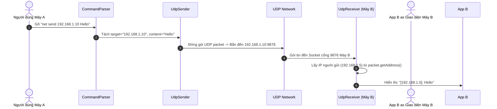

# 📙 PHASE 3: GỬI TIN NHẮN 1 - 1 QUA IP UNICAST

---

## 1. Nhắc lại yêu cầu đề bài cho Phase 3
Trong Phase 3, chúng ta tập trung hoàn thiện chức năng **Gửi tin nhắn trực tiếp đến 1 địa chỉ IP duy nhất (Unicast)** theo cú pháp:
```text
net send {IP_Máy_Nhận} {Nội_dung_tin_nhắn}
```
*Ví dụ*: `net send 192.168.1.10 Hello bạn!`

Khi Máy nhận (`192.168.1.10`) nhận được gói tin, giao diện/màn hình phải hiển thị đúng định dạng:
```text
[192.168.1.5]: Hello bạn!
```
*(Trong đó `192.168.1.5` là IP của Máy gửi được tự động trích xuất từ gói tin).*

---

## 2. Unicast là gì?
- **Unicast (Point-to-Point)** là phương thức truyền tin giữa **một máy gửi (1 Sender)** và **một máy nhận duy nhất (1 Receiver)** trong mạng máy tính.
- Gói tin Unicast có header chứa chính xác IP nguồn (Source IP) và IP đích (Destination IP). Các máy khác trong mạng LAN khi thấy IP đích không phải của mình sẽ lập tức bỏ qua gói tin đó ở tầng Card Mạng (NIC).

---

## 3. Tại sao gửi đến một IP lại là Unicast?
- Vì địa chỉ IP dạng Unicast (ví dụ: `192.168.1.10` hoặc `127.0.0.1`) đại diện cho một giao diện mạng (Network Interface) cụ thể của **duy nhất 1 thiết bị**.
- Khác với Multicast (IP thuộc Class D `224.x.x.x` nhận bởi nhóm máy) hay Broadcast (`255.255.255.255` nhận bởi toàn mạng), Unicast chỉ định đúng 1 địa chỉ đích độc nhất.

---

## 4. Thiết kế & Phân tích cú pháp Command (`CommandParser`)

Khi người dùng nhập chuỗi thô từ bàn phím hoặc ô nhập liệu:
```text
"net send 192.168.1.10 Xin chào Việt Nam"
```

Chúng ta cần phân tách chuỗi này thành 3 thành phần chính:
1. **Command Prefix**: `"net send"` (Từ khóa xác định câu lệnh).
2. **Destination Target**: `"192.168.1.10"` (Tham số thứ nhất - IP đích).
3. **Message Content**: `"Xin chào Việt Nam"` (Phần còn lại - Nội dung tin nhắn).

### Algorithmic Logic trong Java:
```java
// Step 1: Kiểm tra rỗng và chuẩn hóa tiền tố "net send "
if (!input.toLowerCase().startsWith("net send ")) {
    throw new IllegalArgumentException("Lệnh phải bắt đầu bằng 'net send'");
}

// Step 2: Cắt bỏ "net send "
String rest = input.substring(9).trim(); // "192.168.1.10 Xin chào Việt Nam"

// Step 3: Tìm khoảng trắng đầu tiên để tách Target và Content
int spaceIndex = rest.indexOf(' ');
String target = rest.substring(0, spaceIndex).trim();      // "192.168.1.10"
String content = rest.substring(spaceIndex + 1).trim();     // "Xin chào Việt Nam"
```

---

## 5. Hướng dẫn Tự xây dựng Sender (`UdpSender.java`)

### Tại sao lại viết như vậy?
- Máy gửi không cần chọn cổng cố định (OS tự cấp ngẫu nhiên).
- Chuỗi text phải đổi sang mảng `byte[]` UTF-8 để đảm bảo truyền đúng tiếng Việt.
- Dùng `InetAddress.getByName(ip)` để đổi chuỗi IP thành đối tượng IP mạng trong Java.

### Cấu trúc Code Sender từng bước:
```java
public class UdpSender {
    public void sendUnicast(String targetIp, int port, String message) throws Exception {
        // 1. Mở Socket máy gửi
        DatagramSocket socket = new DatagramSocket();

        // 2. Đổi chuỗi text thành mảng byte mã hóa UTF-8
        byte[] data = message.getBytes(StandardCharsets.UTF_8);

        // 3. Đổi chuỗi IP thành đối tượng InetAddress
        InetAddress ipAddress = InetAddress.getByName(targetIp);

        // 4. Đóng gói phong bì DatagramPacket (Data, Length, IP, Port)
        DatagramPacket packet = new DatagramPacket(data, data.length, ipAddress, port);

        // 5. Phát gói tin ra mạng
        socket.send(packet);

        // 6. Đóng socket giải phóng cổng
        socket.close();
    }
}
```

---

## 6. Hướng dẫn Tự xây dựng Receiver (`UdpReceiver.java`)

### Tại sao lại viết như vậy?
- Máy nhận **bắt buộc phải lắng nghe trên cổng quy ước** (ví dụ `9876`).
- Lớp `UdpReceiver` triển khai `Runnable` để chạy trên 1 **Background Thread**, tránh làm nghẽn/đơ giao diện chính.
- Sử dụng `packet.getAddress().getHostAddress()` để tự động trích xuất IP máy gửi từ phong bì UDP.

### Cấu trúc Code Receiver từng bước:
```java
public class UdpReceiver implements Runnable {
    private final int port;
    private volatile boolean running = true;

    public UdpReceiver(int port) {
        this.port = port;
    }

    @Override
    public void run() {
        try (DatagramSocket socket = new DatagramSocket(port)) {
            byte[] buffer = new byte[2048]; // Bộ đệm 2KB hứng dữ liệu

            while (running) {
                // Tạo phong bì rỗng
                DatagramPacket packet = new DatagramPacket(buffer, buffer.length);

                // Chờ nhận gói tin (Blocking)
                socket.receive(packet);

                // Trích xuất tin nhắn và IP nguồn
                String message = new String(packet.getData(), 0, packet.getLength(), StandardCharsets.UTF_8);
                String senderIp = packet.getAddress().getHostAddress();

                // Hiển thị chuẩn đề bài: [IP máy gửi] message
                System.out.println("[" + senderIp + "]: " + message);
            }
        } catch (Exception e) {
            System.err.println("Lỗi Receiver: " + e.getMessage());
        }
    }
}
```

---

## 7. Luồng dữ liệu & Data Tracing Chi Tiết

### 7.1. Sơ đồ Luồng Tổng Thể:



### 7.2. Data Tracing Tin Nhắn `"Hello"`:
1. **User Input (String thô)**: `"net send 192.168.1.10 Hello"`
2. **Sau khi Parse (`ChatMessage` Object)**: `destination="192.168.1.10"`, `content="Hello"`
3. **Trong `UdpSender` (Mảng Byte)**: `byte[] = {72, 101, 108, 108, 111}` (UTF-8)
4. **Header Gói tin UDP**: `[Source IP: 192.168.1.5:54321 | Dest IP: 192.168.1.10:9876 | Length: 5]`
5. **Trong `UdpReceiver`**: 
   - `packet.getData()` ➔ mảng byte `{72, 101, 108, 108, 111}` ➔ Giải mã ➔ `"Hello"`
   - `packet.getAddress().getHostAddress()` ➔ `"192.168.1.5"`
6. **Chuỗi Đầu Ra (Output Display)**: `"[192.168.1.5]: Hello"`

---

## 8. Hướng dẫn Test Thực Tế

### Cách 1: Test trên cùng 1 máy (Localhost / 127.0.0.1)
1. Mở 2 cửa sổ Terminal/Console hoặc 2 Run Configuration trong IntelliJ.
2. Chạy ứng dụng `Main.java`.
3. Gõ lệnh: `net send 127.0.0.1 Xin chao local`
4. Kiểm tra Console hiển thị dòng chữ: `[127.0.0.1]: Xin chao local`

### Cách 2: Test 2 máy trong cùng mạng LAN
1. Mở CMD trên Máy B, gõ `ipconfig` để lấy IP LAN (ví dụ: `192.168.1.20`).
2. Chạy phần mềm trên cả Máy A và Máy B.
3. Trên Máy A gõ: `net send 192.168.1.20 Chào bạn trong mạng LAN`
4. Trên Máy B kiểm tra dòng chữ xuất hiện: `[192.168.1.10]: Chào bạn trong mạng LAN`.

---

## 🧪 9. Bảng 10 Test Cases Phase 3

| Test ID | Nội dung Test | Lệnh Nhập vào | Kết quả Mong Đợi |
| :--- | :--- | :--- | :--- |
| **TC01** | Unicast Localhost | `net send 127.0.0.1 Hello` | In: `[127.0.0.1]: Hello` |
| **TC02** | Unicast IP LAN | `net send 192.168.1.20 Hello LAN` | In: `[192.168.1.10]: Hello LAN` trên máy nhận |
| **TC03** | Tin nhắn có khoảng trắng | `net send 127.0.0.1 Xin chao tat ca` | In đúng chuỗi: `Xin chao tat ca` |
| **TC04** | Tin nhắn tiếng Việt | `net send 127.0.0.1 Lập trình mạng Java` | Đọc đúng tiếng Việt UTF-8 không lỗi font |
| **TC05** | Message rỗng | `net send 127.0.0.1` | Báo lỗi cú pháp: `Thiếu nội dung tin nhắn!` |
| **TC06** | Sai định dạng IP | `net send 300.500.1.1 Hello` | Báo lỗi mạng: `UnknownHostException` |
| **TC07** | Nhập câu lệnh sai tiền tố | `send 127.0.0.1 Hello` | Báo lỗi: `Lệnh phải bắt đầu bằng net send` |
| **TC08** | Message siêu dài (1000 ký tự)| `net send 127.0.0.1 [Đoạn văn dài]` | Receiver nhận trọn vẹn 1000 ký tự |
| **TC09** | Nhập lệnh exit | `exit` | Thoát chương trình an toàn |
| **TC10** | Chuỗi lệnh có nhiều space | `net send   127.0.0.1   Test space` | Parse đúng IP `127.0.0.1` và msg `Test space` |

---

## 🐞 10. Bài tập Debug Tìm Lỗi Cố Ý (Phase 3)

Hãy soi đoạn code dưới đây và tự tìm ra **3 lỗi sai nghiêm trọng**:

```java
// CODE BỊ LỖI CỐ Ý - HÃY TÌM 3 LỖI SAI:
public class FaultySender {
    public static void main(String[] args) throws Exception {
        String input = "net send 127.0.0.1 Hello World";
        String[] parts = input.split(" "); 
        String ip = parts[1]; // Lỗi 1?
        String msg = parts[2]; // Lỗi 2?

        DatagramSocket socket = new DatagramSocket(9876); // Lỗi 3?
        byte[] data = msg.getBytes(); 
        
        DatagramPacket packet = new DatagramPacket(data, data.length, InetAddress.getByName(ip), 9876);
        socket.send(packet);
    }
}
```

---

## ❓ 11. 10 Câu hỏi Vấn đáp Phase 3

1. Unicast khác gì so với Multicast và Broadcast?
2. Tại sao câu lệnh `net send 192.168.1.10 Hello` lại xếp vào chế độ Unicast?
3. Tại sao không nên dùng `input.split(" ")` để tách `message` trong câu lệnh `net send`?
4. Làm thế nào để lấy IP của máy gửi từ gói `DatagramPacket` nhận được?
5. Tại sao máy gửi không cần cố định Port (ví dụ `new DatagramSocket()`) mà máy nhận lại cần (`new DatagramSocket(9876)`)?
6. Nếu máy A gửi Unicast đến IP `192.168.1.99` (không tồn tại trong LAN), lệnh `socket.send()` có văng Exception không? Tại sao?
7. Vai trò của `StandardCharsets.UTF_8` khi tạo `String` từ `packet.getData()` là gì?
8. Tại sao Receiver lại cần nhận dữ liệu dựa trên `packet.getLength()` thay vì `packet.getData().length`?
9. Nếu chạy 2 ứng dụng Receiver trên cùng 1 máy gắn chung cổng 9876, điều gì xảy ra?
10. Tại sao ta lại khởi tạo `UdpReceiver` chạy trên 1 `Thread` riêng biệt?

---

## ✏️ 12. Bài tập Nâng cấp Mở rộng Phase 3

1. **Bài tập 1 (Gửi nhiều tin nhắn)**: Cho phép người dùng gõ lệnh `net send` liên tục từ bàn phím cho tới khi gõ `exit`.
2. **Bài tập 2 (Lưu Lịch sử Tin nhắn)**: Tạo lớp `MessageHistoryManager` lưu danh sách các tin nhắn đã nhận trong bộ nhớ (`List<ChatMessage>`) và cho phép gõ lệnh `history` để xem lại.
3. **Bài tập 3 (Định dạng Thời gian)**: Cập nhật Receiver in ra kèm mốc thời gian: `[17:30:45] [192.168.1.5]: Hello`.

---

## ✅ CHECKPOINT PHASE 3

- [ ] Hiểu rõ khái niệm và cơ chế truyền tin Unicast (1-1).
- [ ] Phân tích chính xác câu lệnh `net send {IP} {message}`.
- [ ] Trích xuất đúng IP người gửi từ gói `DatagramPacket`.
- [ ] Tự giải thích luồng dữ liệu thô biến đổi qua từng tầng.
- [ ] Tự viết lại được 2 lớp `UdpSender` và `UdpReceiver` Unicast mà không cần nhìn code mẫu.

> ⛔ **YÊU CẦU BẮT BUỘC**: Bạn hãy tự tay viết lại 2 lớp Sender và Receiver Unicast, sau đó giải thích ngắn gọn luồng hoạt động cho tôi. Chỉ khi bạn xác nhận đã hoàn thành mới chuyển sang **PHASE 4: MULTICAST GROUP**.
