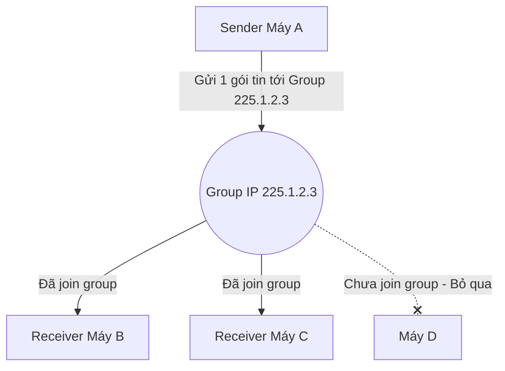
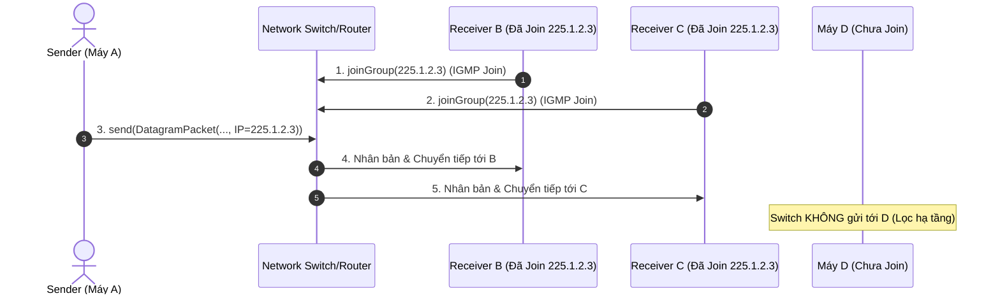

# 📕 PHASE 4: KĨ THUẬT MULTICAST GROUP IN JAVA

---

## 1. Giải thích Multicast bằng Ví dụ Đời Thường
- **Ví dụ đời thường**: Hãy tưởng tượng một **Kênh Tần Số Bộ Đàm (Walkie-Talkie)** hoặc một **Kênh Truyền Hình Cáp**.
  - **Unicast**: Giống như bạn gọi điện thoại riêng cho 1 người. Chỉ có người đó nghe được.
  - **Broadcast**: Giống như bạn bật loa phóng thanh công cộng ở làng. Bất kỳ ai trong làng đều nghe thấy (dù muốn hay không).
  - **Multicast**: Giống như bạn chỉnh tần số bộ đàm sang "Kênh 5". **Chỉ những ai chỉnh bộ đàm đúng Kênh 5 mới nghe thấy bạn nói**. Những người ở kênh khác sẽ hoàn toàn không bị làm phiền.

---

## 2. Bảng So sánh Unicast vs Multicast vs Broadcast

| Tiêu chí | Unicast (1 - 1) | Multicast (1 - Nhóm) | Broadcast (1 - Tất cả) |
| :--- | :--- | :--- | :--- |
| **Đối tượng nhận** | 1 máy cụ thể | Các máy đăng ký (Join) vào Nhóm | Tất cả máy trong cùng mạng LAN |
| **Dải địa chỉ IP** | IP máy (vd: `192.168.1.10`) | IP Group Class D (`224.0.0.0` - `239.255.255.255`) | IP Broadcast (`255.255.255.255`) |
| **Lớp Java Socket**| `DatagramSocket` | `MulticastSocket` | `DatagramSocket` (`setBroadcast(true)`) |
| **Đăng ký tham gia**| Không cần | **Bắt buộc gọi `joinGroup()`** | Không cần |
| **Tải trên mạng** | Tải tăng theo số máy nhận (N gói) | Gửi đúng 1 gói tin, Router nhân bản cho nhóm | 1 gói tin gửi tới toàn bộ thiết bị |

---

## 3. Sơ đồ Cơ chế Multicast Group



---

## 4. Giải thích Multicast Group Address (Class D IP)
- Địa chỉ IP Multicast nằm trong dải **Class D**: từ `224.0.0.0` đến `239.255.255.255`.
- **Phân dải địa chỉ**:
  - `224.0.0.0` - `224.0.0.255`: Dành riêng cho hệ thống và protocol mạng (vd: `224.0.0.1` = tất cả host).
  - `224.0.1.0` - `238.255.255.255`: Dải Multicast dùng tự do cho ứng dụng lập trình (Khuyên dùng: `225.1.2.3` hoặc `230.0.0.1`).
  - `239.0.0.0` - `239.255.255.255`: Dải Administrative / Private cho mạng LAN nội bộ.

---

## 5. Cách một Receiver tham gia Group (IGMP Protocol)
- Khi máy nhận gọi hàm `multicastSocket.joinGroup(groupAddress)`:
  1. Ở tầng mạng, HĐH phát một bản tin **IGMP (Internet Group Management Protocol)** báo cho Switch/Router mạng biết máy này muốn lắng nghe địa chỉ Multicast IP đó.
  2. Card mạng (NIC) bắt đầu cho phép các khung gói tin có IP đích Multicast đi qua bộ lọc phần cứng vào ứng dụng Java.

---

## 6. Lớp `MulticastSocket` trong Java
- `MulticastSocket` là lớp con **kế thừa từ `DatagramSocket`**.
- Bổ sung thêm các năng lực đặc biệt mà `DatagramSocket` không có:
  1. `joinGroup(InetAddress group)`: Đăng ký nhận gói tin từ nhóm Multicast.
  2. `leaveGroup(InetAddress group)`: Hủy đăng ký, rời khỏi nhóm.
  3. `setTimeToLive(int ttl)`: Giới hạn phạm vi phát gói tin Multicast (TTL = 1: Chỉ trong LAN; TTL = 32: Trong nội bộ công ty).

---

## 7. Giải thích 4 hàm quan trọng trong Multicast

1. **`joinGroup(InetAddress group)`**:
   - *TẠI SAO CẦN*: Để báo cho Switch/HĐH lắng nghe các gói tin gửi tới địa chỉ Group IP này.
2. **`leaveGroup(InetAddress group)`**:
   - *TẠI SAO CẦN*: Để hủy đăng ký khi không muốn nhận tin nhóm nữa, tránh làm tốn tài nguyên CPU/Network.
3. **`send(DatagramPacket packet)`**:
   - *TẠI SAO CẦN*: Đẩy gói tin chứa IP đích Multicast ra ngoài mạng.
4. **`receive(DatagramPacket packet)`**:
   - *TẠI SAO CẦN*: Tạm dừng tiến trình (Blocking) cho đến khi có gói tin Multicast gửi tới Group đã Join.

---

## 8. DatagramPacket trong Multicast
- `DatagramPacket` trong Multicast có cấu trúc **hệt như trong UDP Unicast**.
- Điểm khác biệt duy nhất: `InetAddress destinationIP` truyền vào constructor của Packet là một **Multicast IP** (vd: `225.1.2.3`).

---

## 9. Sơ đồ Luồng Mạng Multicast Chi Tiết



---

## 10. Code Multicast Tối Thiểu (Chương trình mẫu)

### 📄 Receiver Multicast: `MulticastReceiver.java`
*(Đã khởi tạo tại `src/network/MulticastReceiver.java`)*:
```java
MulticastSocket socket = new MulticastSocket(9876);
InetAddress group = InetAddress.getByName("225.1.2.3");
socket.joinGroup(group); // Đăng ký tham gia nhóm

byte[] buffer = new byte[1024];
DatagramPacket packet = new DatagramPacket(buffer, buffer.length);
socket.receive(packet); // Chờ nhận tin nhắn từ nhóm

String msg = new String(packet.getData(), 0, packet.getLength(), StandardCharsets.UTF_8);
System.out.println("Nhận từ nhóm 225.1.2.3: " + msg);
```

---

## 11. Cách `CommandParser` Phân Biệt IP Unicast, Multicast và `*`

Trong lớp [CommandParser.java](file:///d:/Lap_Trinh_Mang/Lab6_Multicast/src/parser/CommandParser.java), cú pháp được tự động nhận diện như sau:

```java
if (target.equals("*")) {
    type = TargetType.BROADCAST;
} else {
    InetAddress addr = InetAddress.getByName(target);
    if (addr.isMulticastAddress()) {
        type = TargetType.MULTICAST; // Thuộc dải 224.0.0.0 đến 239.255.255.255
    } else {
        type = TargetType.UNICAST;   // IP máy đơn lẻ (vd: 192.168.1.10)
    }
}
```

---

## 12. Hướng dẫn Test Multicast trên 3 Cửa Sổ Terminal / IntelliJ

Để kiểm tra tính chất **1 Sender gửi -> Nhiều Receiver nhận cùng lúc**:

1. **Mở 3 cửa sổ Console/Terminal trên máy bạn**:
   - Cửa sổ 1: Máy A (Gửi)
   - Cửa sổ 2: Máy B (Nhận - Join `225.1.2.3`)
   - Cửa sổ 3: Máy C (Nhận - Join `225.1.2.3`)
2. Trên Cửa sổ 1 (Máy A), gõ lệnh:
   ```text
   net send 225.1.2.3 Xin chào cả nhóm Multicast!
   ```
3. **Kết quả**: Cả Cửa sổ 2 (Máy B) và Cửa sổ 3 (Máy C) **đồng thời hiển thị** tin nhắn!

---

## 🧪 13. Bảng Test Cases Multicast Matrix

| Test ID | Kịch bản Test | Lệnh Nhập vào | Kết quả Mong Đợi |
| :--- | :--- | :--- | :--- |
| **TC01** | Gửi Multicast 1 Receiver | `net send 225.1.2.3 Hello Group` | Receiver đã join 225.1.2.3 nhận được tin nhắn |
| **TC02** | Gửi Multicast N Receiver | `net send 225.1.2.3 Alo nhóm` | Tất cả máy trong nhóm 225.1.2.3 cùng nhận được |
| **TC03** | Receiver đã rời nhóm | Gọi `leaveGroup()` rồi gửi | Receiver không nhận được tin nhắn nhóm nữa |
| **TC04** | Nhập IP Group sai dải | `net send 200.1.1.1 Hello` | Chuyển sang chế độ Unicast (không phải Multicast) |
| **TC05** | Nhập IP rác không hợp lệ | `net send 999.999.1.1 Hi` | Báo lỗi `IP không hợp lệ` |

---

## 🐞 14. Bài tập Debug Multicast (Tìm 3 lỗi cố ý)

Hãy tìm 3 lỗi sai trong đoạn code MulticastReceiver dưới đây:

```java
// CODE BỊ LỖI CỐ Ý:
DatagramSocket socket = new DatagramSocket(9876); // Lỗi 1?
InetAddress group = InetAddress.getByName("192.168.1.10"); // Lỗi 2?
socket.joinGroup(group); // Lỗi 3?
```

---

## ❓ 15. 15 Câu hỏi Vấn đáp Chuyên sâu MulticastSocket

1. MulticastSocket khác gì so với DatagramSocket?
2. Dải địa chỉ IP Multicast nằm trong khoảng nào?
3. Tại sao địa chỉ `192.168.1.20` lại không thể dùng làm IP Multicast Group?
4. Phương thức `joinGroup()` giữ vai trò gì ở tầng mạng?
5. Nếu Receiver không gọi `joinGroup()`, gói tin Multicast phát ra có tới được ứng dụng không?
6. Chuyện gì xảy ra khi Receiver gọi `leaveGroup()`?
7. Giao thức nào ở tầng Mạng chịu trách nhiệm quản lý nhóm Multicast giữa Host và Switch?
8. Tại sao Multicast lại tiết kiệm băng thông mạng hơn Unicast khi phát dữ liệu cho 100 người cùng lúc?
9. Thuộc tính TTL (Time To Live) trong MulticastSocket có ý nghĩa gì?
10. Tại sao ta không dùng TCP để triển khai Multicast?
11. Phương thức `inetAddress.isMulticastAddress()` kiểm tra điều gì?
12. Khi Sender gửi gói tin tới Multicast IP `225.1.2.3`, Sender có cần gọi `joinGroup()` không? *(Gợi ý: Sender chỉ cần gửi, không cần join nhóm trừ khi muốn tự nhận tin nhắn của chính mình).*
13. Nếu có 2 nhóm Multicast khác nhau (`225.1.1.1` và `225.2.2.2`) cùng chạy trên port 9876, các gói tin có bị trộn lẫn không?
14. Trong mô hình ứng dụng Net Send của chúng ta, làm sao để phân biệt được gói tin đến là Unicast hay Multicast?
15. Tại sao phải đóng `MulticastSocket` trong khối `finally` khi ứng dụng kết thúc?

---

## ✅ CHECKPOINT PHASE 4

- [ ] Giải thích được Multicast bằng ví dụ đời thường.
- [ ] Phân biệt được `DatagramSocket` và `MulticastSocket`.
- [ ] Nắm vững dải IP Class D (`224.0.0.0` - `239.255.255.255`).
- [ ] Nắm rõ vai trò của `joinGroup()` và `leaveGroup()`.
- [ ] Test thành công gửi tin nhắn nhóm tới Multicast IP.

> ⛔ **YÊU CẦU BẮT BUỘC TRƯỚC KHI SANG PHASE 5**:
> Bạn hãy tự giải thích bằng lời của bạn:
> **"Dữ liệu tin nhắn đi từ Máy gửi (Sender) tới nhiều Máy nhận (Receivers) trong nhóm Multicast như thế nào? Điểm khác biệt lớn nhất giữa `DatagramSocket` và `MulticastSocket` là gì?"**
