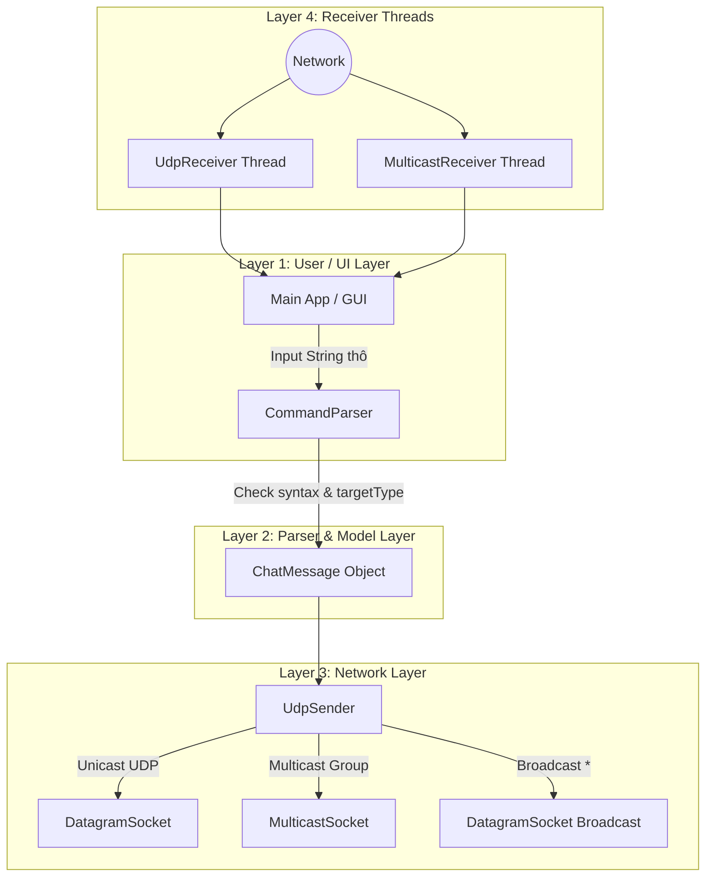
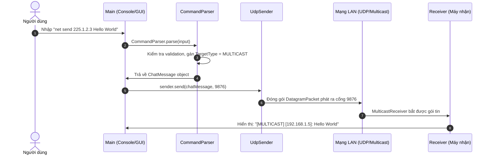

# 📘 PHASE 5: TÍCH HỢP HOÀN CHỈNH BỘ PHÂN TÍCH CÚ PHÁP COMMAND PARSER

---

## 1. Phân tích Cú pháp Command `net send {IP | group | *} message`

Cú pháp tổng quát của đề bài bao gồm 3 thành phần chính:
```text
  net send      {192.168.1.10 | 225.1.2.3 | *}      Xin chào Việt Nam!
     │                         │                            │
[ Command ]            [ Destination ]                 [ Message ]
```

1. **`Command`**: Từ khóa cố định `"net send "` (không phân biệt hoa thường).
2. **`Destination`**: Địa chỉ máy đích/nhóm đích, có thể rơi vào 3 trường hợp:
   - **IP Unicast** (vd: `192.168.1.10`): Gửi 1 - 1.
   - **Group Multicast** (vd: `225.1.2.3`): Gửi 1 - Nhóm (IP Class D `224.0.0.0` đến `239.255.255.255`).
   - **`*` (Broadcast / All)**: Gửi 1 - Tất cả các máy trong mạng LAN.
3. **`Message`**: Chuỗi nội dung văn bản (có thể chứa nhiều từ, khoảng trắng và chữ tiếng Việt).

---

## 2. Giải thích Chi tiết Ký hiệu `*` vs Multicast

> [!WARNING]
> **KHÔNG ĐƯỢC ĐÁNH ĐỒNG `*` VỚI MULTICAST!**

- **Bản chất của `*` (Broadcast)**:
  - Khi người dùng gõ `*`, mục đích là phát gói tin tới **TẤT CẢ các thiết bị trong mạng LAN** mà không cần thiết bị đó phải đăng ký nhóm nào trước.
  - Gói tin được đóng gói gửi đến địa chỉ Broadcast `255.255.255.255`.
- **Bản chất của Multicast (`group`)**:
  - Chỉ gửi tới **MỘT NHÓM MÁY CỤ THỂ** đã chủ động gọi `joinGroup()` vào IP Class D tương ứng (vd: `225.1.2.3`). Các máy khác trong LAN hoàn toàn không nhận được.

---

## 3. Thuật toán Phân tích Cú pháp (Command Parsing Algorithm)

Để **không bị mất tin nhắn có nhiều từ** (vd: `"Xin chào các bạn sinh viên"`), ta **KHÔNG DÙNG `split(" ")`**. 

Thuật toán xử lý trong [CommandParser.java](file:///d:/Lap_Trinh_Mang/Lab6_Multicast/src/parser/CommandParser.java):
```java
// 1. Kiểm tra tiền tố "net send "
if (!trimmed.toLowerCase().startsWith("net send ")) {
    throw new IllegalArgumentException("Cú pháp không hợp lệ!");
}

// 2. Cắt bỏ tiền tố "net send "
String rest = trimmed.substring(9).trim(); // "225.1.2.3 Xin chào các bạn"

// 3. Tìm vị trí khoảng trắng ĐẦU TIÊN để tách Destination và Message
int firstSpace = rest.indexOf(' ');
String destination = rest.substring(0, firstSpace).trim(); // "225.1.2.3"
String messageContent = rest.substring(firstSpace + 1).trim(); // "Xin chào các bạn"
```

---

## 4. Sơ đồ Kiến trúc Phân tầng Mới (Layered Architecture)



---

## 5. Luồng Truyền Nhận Tin Nhắn Hoàn Chỉnh



---

## 💻 6. Mã Nguồn Đã Hoàn Thiện Trong Thư Mục Dự Án

Toàn bộ mã nguồn Phase 5 đã được cập nhật trực tiếp tại:
- 📄 **CommandParser**: [CommandParser.java](file:///d:/Lap_Trinh_Mang/Lab6_Multicast/src/parser/CommandParser.java) *(Hỗ trợ net send + help + clear + exit)*
- 📄 **TargetType Enum**: [TargetType.java](file:///d:/Lap_Trinh_Mang/Lab6_Multicast/src/model/TargetType.java)
- 📄 **ChatMessage Model**: [ChatMessage.java](file:///d:/Lap_Trinh_Mang/Lab6_Multicast/src/model/ChatMessage.java)
- 📄 **UdpSender**: [UdpSender.java](file:///d:/Lap_Trinh_Mang/Lab6_Multicast/src/network/UdpSender.java)
- 📄 **UdpReceiver**: [UdpReceiver.java](file:///d:/Lap_Trinh_Mang/Lab6_Multicast/src/network/UdpReceiver.java)
- 📄 **MulticastReceiver**: [MulticastReceiver.java](file:///d:/Lap_Trinh_Mang/Lab6_Multicast/src/network/MulticastReceiver.java)
- 📄 **Main Executable**: [Main.java](file:///d:/Lap_Trinh_Mang/Lab6_Multicast/src/app/Main.java)

---

## 🧪 7. Bảng Kịch bản Test Case Hoàn Chỉnh (Test Matrix)

| Test ID | Câu lệnh Nhập vào | Loại tin nhắn | Kết quả Mong Đợi |
| :--- | :--- | :--- | :--- |
| **TC01** | `net send 127.0.0.1 Hello Unicast` | Unicast | Gửi thành công tới `127.0.0.1` |
| **TC02** | `net send 225.1.2.3 Hello Group` | Multicast | Gửi thành công tới nhóm `225.1.2.3` |
| **TC03** | `net send * Hello All` | Broadcast | Gửi thành công tới `255.255.255.255` |
| **TC04** | `net send 127.0.0.1 Xin chào Việt Nam nhiều từ`| Unicast Multi-word | Không bị mất từ, nhận đầy đủ chuỗi |
| **TC05** | `help` | Lệnh trợ giúp | Hiển thị bảng hướng dẫn cú pháp |
| **TC06** | `clear` | Lệnh hệ thống | Xóa màn hình Console |
| **TC07** | `exit` | Lệnh hệ thống | Đóng socket và thoát an toàn |
| **TC08** | `send 127.0.0.1 Hello` | Lỗi cú pháp | Báo lỗi: `Cú pháp phải bắt đầu bằng net send...` |
| **TC09** | `net send 999.999.999.999 Hi` | Lỗi IP rác | Báo lỗi: `Địa chỉ IP hoặc Group không hợp lệ` |
| **TC10** | `net send 127.0.0.1` | Lỗi thiếu msg | Báo lỗi: `Thiếu nội dung tin nhắn!` |

---

## ❓ 8. 15 Câu hỏi Vấn đáp Chuyên sâu Phase 5

1. Tại sao ta phải tạo lớp `CommandParser` riêng biệt mà không phân tích chuỗi trực tiếp ở GUI/Main?
2. Sự khác nhau giữa ký hiệu `*` (Broadcast) và địa chỉ IP `group` (Multicast) là gì?
3. Tại sao không được dùng `input.split(" ")` để tách lệnh `net send`?
4. Làm thế nào `CommandParser` tự động phân biệt được địa chỉ IP truyền vào là Unicast hay Multicast?
5. Phương thức `inetAddress.isMulticastAddress()` kiểm tra dải IP nào?
6. Nếu người dùng nhập `net send 127.0.0.1` (thiếu message), Parser sẽ xử lý như thế nào?
7. Sự khác nhau giữa `IllegalArgumentException` và ngoại lệ mạng `UnknownHostException` là gì?
8. Tại sao `TargetType` lại được thiết kế ở dạng `enum` mà không dùng chuỗi String?
9. Đối tượng `ChatMessage` đóng vai trò gì giữa các tầng Parser, Network và GUI?
10. Làm thế nào để thêm một lệnh tiện ích mới (như `clear` hoặc `help`) vào `CommandParser`?
11. Tại sao ta lại cho `UdpReceiver` và `MulticastReceiver` chạy trên 2 Thread riêng biệt?
12. Nếu địa chỉ IP truyền vào là `224.0.0.1`, Parser sẽ xếp vào loại `UNICAST` hay `MULTICAST`?
13. Nếu người dùng gõ `NET SEND 127.0.0.1 Hello` (chữ in hoa), Parser có hoạt động đúng không? Tại sao?
14. Hàm `substring(9)` trong Parser có ý nghĩa gì?
15. Tại sao việc tách biệt Layer (Parser - Network - Model - UI) giúp chúng ta chuyển sang Phase 6 (Dựng Swing GUI) rất dễ dàng?

---

## ✅ CHECKPOINT PHASE 5

- [x] Phân tích hoàn chỉnh cú pháp `net send {IP | group | *} message`.
- [x] Phân biệt rõ rệt `*` (Broadcast) với Multicast Group IP.
- [x] Không bị rò rỉ hay mất từ đối với tin nhắn chứa nhiều từ.
- [x] Bắt toàn bộ lỗi cú pháp và lỗi IP không hợp lệ.
- [x] Hỗ trợ thêm các câu lệnh tiện ích: `help`, `clear`, `exit`.

> ⛔ **BÀI KIỂM TRA CUỐI PHASE 5**:
> Bạn hãy tự viết lại một hàm `parseCommand(String input)` đơn giản theo cách hiểu của bạn (hoặc tự giải thích lại thuật toán tách chuỗi `substring` và `indexOf(' ')`). 
> Ngay khi bạn hoàn thành, chúng ta sẽ bước vào **PHASE 6: XÂY DỰNG GIAO DIỆN GUI SWING HOÀN CHỈNH!**
