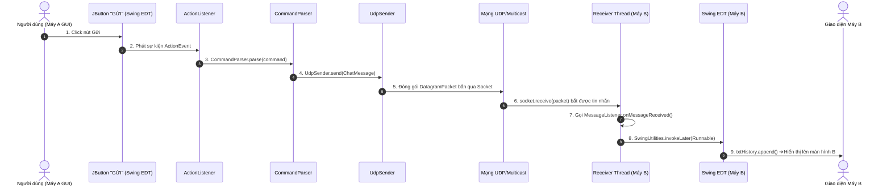

# 🎨 PHASE 6: XÂY DỰNG GIAO DIỆN ĐỒ HỌA SWING HOÀN CHỈNH (SWING GUI)

---

## 1. Khái niệm Lập trình Hướng Sự Kiện (Event-Driven Programming) trong Swing

- trong lập trình Console (Phase 1-5), chương trình chạy từ trên xuống dưới theo thứ tự tuyến tính trong hàm `main()`.
- Trong giao diện đồ họa **GUI**, chương trình chuyển sang mô hình **Hướng sự kiện (Event-Driven)**:
  - Ứng dụng vẽ xong giao diện và rơi vào trạng thái **lắng nghe sự kiện (Event Loop)**.
  - Khi người dùng click chuột vào `JButton`, gõ phím vào `JTextField`, hay chọn `JRadioButton`, hệ điều hành tạo ra các đối tượng **`ActionEvent`**.
  - Các hàm lắng nghe **`ActionListener`** sẽ lập tức được kích hoạt để xử lý tác vụ tương ứng.

---

## 2. Giải thích 10 Thành phần Swing Cốt lõi

1. **`JFrame`**: Cửa sổ ứng dụng chính (chứa thanh tiêu đề, nút Đóng/Thu nhỏ và các Panel con).
2. **`JPanel`**: Vùng không gian (Container) dùng để nhóm các linh kiện liên quan lại với nhau.
3. **`JTextField`**: Ô nhập liệu 1 dòng văn bản (dùng nhập IP, tin nhắn, câu lệnh).
4. **`JTextArea`**: Vùng hiển thị văn bản nhiều dòng (dùng làm Khung Nhật ký tin nhắn).
5. **`JButton`**: Nút bấm kích hoạt hành động (dùng cho nút Gửi, Xóa, Join/Leave group).
6. **`JRadioButton` / `ButtonGroup`**: Nút chọn 1 trong nhiều chế độ (Unicast, Multicast, Broadcast).
7. **`JLabel`**: Nhãn hiển thị văn bản cố định (dùng hiển thị IP máy, Port, Trạng thái kết nối).
8. **`ActionListener`**: Interface chịu trách nhiệm xử lý sự kiện khi người dùng tương tác với nút bấm/ô nhập liệu.
9. **`JScrollPane`**: Thanh cuộn tự động bọc quanh `JTextArea` khi tin nhắn tràn màn hình.
10. **`Layout Manager` (BorderLayout, GridBagLayout, FlowLayout, GridLayout)**: Bộ quản lý sắp xếp vị trí và kích thước các linh kiện tự động co giãn theo cửa sổ.

---

## 3. Sơ đồ Cấu trúc Vùng Giao diện (Wireframe & Layout)

```text
┌─────────────────────────────────────────────────────────────────────────────┐
│ 🟢 BẢNG TRẠNG THÁI MẠNG (NORTH - FlowLayout)                                │
│ Trạng thái: Đang Lắng Nghe | IP Máy này: 192.168.1.15 | Port: 9876 | Group: 225.1.2.3│
├─────────────────────────────────────────────────────────────────────────────┤
│ 🔵 VÙNG NHẬT KÝ VÀ LOG (CENTER - GridLayout 1x2)                            │
│ ┌──────────────────────────────────────┐ ┌────────────────────────────────┐ │
│ │ NHẬT KÝ TIN NHẮN NHẬN ĐƯỢC (History) │ │ LỊCH SỬ HOẠT ĐỘNG (System Log) │ │
│ │ [17:30:15] [UNICAST] Từ 192.168.1.10 │ │ [17:30:00] Đã bật Receiver    │ │
│ │            ➔ Hello Java Swing!       │ │ [17:30:15] Nhận gói UDP       │ │
│ └──────────────────────────────────────┘ └────────────────────────────────┘ │
├─────────────────────────────────────────────────────────────────────────────┤
│ 🟡 BỘ GỬI TIN NHẮN & QUẢN LÝ (SOUTH - Box & GridBagLayout)                  │
│ Chế độ: (•) Unicast (1-1)   ( ) Multicast (Nhóm)   ( ) Broadcast (*)       │
│ Destination: [ 127.0.0.1             ]                                      │
│ Message:     [ Nhập tin nhắn ở đây... ] [ 🚀 GỬI (NET SEND) ] [ 🧹 Xóa Log ] │
│ Lệnh thô:    [ net send 225.1.2.3 Hello Multicast GUI    ] [ Thực thi ]   │
│                                                                             │
│ 🔴 QUẢN LÝ MULTICAST GROUP                                                  │
│ IP Group: [ 225.1.2.3 ]  [ Join Group ]  [ Leave Group ]  [ Tắt Lắng Nghe ]  │
└─────────────────────────────────────────────────────────────────────────────┘
```

---

## 4. Đa Tiến Trình trong Swing & Quy Tắc An Toàn EDT (Event Dispatch Thread)

> [!CRITICAL]
> **TẠI SAO KHÔNG ĐƯỢC CHẠY `socket.receive()` TRỰC TIẾP TRÊN GIAO DIỆN?**

1. Swing sử dụng một luồng duy nhất gọi là **Event Dispatch Thread (EDT)** để vẽ giao diện và phản hồi sự kiện chuột/phím.
2. Hàm `socket.receive()` trong UDP là một hàm **Blocking (Chờ nghẽn)**.
3. Nếu bạn gọi `socket.receive()` trên EDT, luồng giao diện sẽ bị "đóng băng" (Freeze/Not Responding). Người dùng không thể di chuyển cửa sổ hay bấm bất kỳ nút nào.

### Giải pháp Kiến trúc chuẩn:
- **`UdpReceiver`** và **`MulticastReceiver`** chạy trên 2 **Background Threads riêng biệt**.
- Khi nhận được gói tin mạng, Background Thread gọi interface [`MessageListener`](file:///d:/Lap_Trinh_Mang/Lab6_Multicast/src/network/MessageListener.java).
- Trong callback của Listener, ta dùng **`SwingUtilities.invokeLater(...)`** để đẩy việc cập nhật chuỗi lên `JTextArea` về lại luồng EDT một cách **Thread-safe**!

---

## 5. Sơ đồ Luồng Truyền Nhận Tin Nhắn Từ GUI Đến GUI



---

## 💻 6. Mã Nguồn Giao Diện Đã Tạo Hoàn Chỉnh

Toàn bộ lớp giao diện đồ họa đã được tạo trong dự án của bạn:
- 📄 **Main GUI**: [MainFrame.java](file:///d:/Lap_Trinh_Mang/Lab6_Multicast/src/gui/MainFrame.java) *(Cửa sổ GUI Swing 4 khu vực)*
- 📄 **GUI Main Launcher**: [GuiMain.java](file:///d:/Lap_Trinh_Mang/Lab6_Multicast/src/app/GuiMain.java) *(Khởi chạy Swing EDT)*
- 📄 **MessageListener Interface**: [MessageListener.java](file:///d:/Lap_Trinh_Mang/Lab6_Multicast/src/network/MessageListener.java) *(Callback truyền dữ liệu từ Network lên GUI)*

---

## 🚀 7. HƯỚNG DẪN CHẠY DỰ ÁN GIAO DIỆN GUI

1. Mở file [GuiMain.java](file:///d:/Lap_Trinh_Mang/Lab6_Multicast/src/app/GuiMain.java) trong IntelliJ.
2. Nhấn **Run** (hoặc `Shift + F10`).
3. Cửa sổ giao diện đồ họa Swing đẹp mắt sẽ xuất hiện trên màn hình.
4. **Thử nghiệm gửi tin nhắn**:
   - Chọn Radio `Multicast (Nhóm)`.
   - Nhập nội dung: `Xin chào từ giao diện đồ họa GUI Swing!`.
   - Bấm nút **🚀 GỬI (NET SEND)**.
   - Quan sát ô **NHẬN TIN NHẮN** lập tức hiển thị dòng chữ tin nhắn với mốc thời gian thực!

---

## 🧪 8. Bảng Kịch bản Test GUI & Network Matrix

| Test ID | Thao tác trên GUI | Kết quả Mong Đợi |
| :--- | :--- | :--- |
| **TC01** | Chọn Radio `Unicast`, bấm Gửi | Nhập vào ô history với nhãn `[UNICAST]` |
| **TC02** | Chọn Radio `Multicast`, bấm Gửi | Nhập vào ô history với nhãn `[MULTICAST]` |
| **TC03** | Chọn Radio `Broadcast`, bấm Gửi | Nhập vào ô history với nhãn `[BROADCAST]` |
| **TC04** | Nhập câu lệnh thô ở ô dưới ➔ Bấm Thực Thi | Parse và gửi đi chính xác |
| **TC05** | Nhập IP nhóm mới `230.0.0.1` ➔ Bấm `Join Group` | Đã đổi nhóm Multicast thành `230.0.0.1` trên Status bar |
| **TC06** | Bấm `Tắt Lắng Nghe` | Chuyển trạng thái màu đỏ `Đã Tắt`, dừng nhận tin |
| **TC07** | Bấm `🧹 Xóa Nhật Ký` | Xóa sạch văn bản trong 2 ô JTextArea |

---

## ❓ 9. 15 Câu hỏi Vấn đáp Chuyên sâu GUI + Networking

1. Lập trình Hướng sự kiện (Event-Driven) khác gì lập trình tuyến tính Console?
2. Vai trò của `JFrame`, `JPanel` và `LayoutManager` trong Swing là gì?
3. Tại sao không được gọi `socket.receive()` trực tiếp trong phương thức `actionPerformed` của `JButton`?
4. Swing Event Dispatch Thread (EDT) là gì?
5. Hàm `SwingUtilities.invokeLater()` giải quyết vấn đề gì khi lập trình Mạng kết hợp GUI?
6. Interface `MessageListener` giúp tách biệt tầng Network và tầng GUI như thế nào?
7. Sự khác biệt giữa `JTextArea` và `JTextField` là gì?
8. Tại sao ta phải bọc `JTextArea` trong một `JScrollPane`?
9. Hàm `txtHistory.setCaretPosition(txtHistory.getDocument().getLength())` có tác dụng gì?
10. Khi bấm nút `Tắt Lắng Nghe`, làm thế nào GUI dừng được tiến trình `UdpReceiver` đang nghẽn?
11. Tại sao ta gọi `thread.setDaemon(true)` cho các Receiver Threads khi chạy kèm GUI Swing?
12. Thuộc tính `volatile boolean running` trong `UdpReceiver` giúp ích gì khi tương tác từ GUI nút Bật/Tắt?
13. Khi khởi chạy GUI, tại sao ta lại bọc trong `SwingUtilities.invokeLater(() -> new MainFrame())` ở file `GuiMain.java`?
14. Nếu người dùng nhập nội dung rỗng trên GUI và bấm Gửi, giao diện xử lý ra sao?
15. Làm thế nào để mở 2 cửa sổ GUI `MainFrame` trên 2 máy khác nhau để trò chuyện qua mạng LAN?

---

## ✅ CHECKPOINT PHASE 6

- [x] Thiết kế giao diện Swing GUI 4 khu vực hoàn chỉnh.
- [x] Tái sử dụng 100% mã nguồn Networking (`UdpSender`, `UdpReceiver`, `MulticastReceiver`, `CommandParser`).
- [x] Áp dụng mô hình Thread-safe với `SwingUtilities.invokeLater()`.
- [x] Không làm treo/đơ giao diện GUI khi đang lắng nghe gói tin mạng.
- [x] Hỗ trợ nút Join/Leave Multicast Group và nút Bật/Tắt lắng nghe.

> ⛔ **YÊU CẦU BẮT BUỘC TRƯỚC KHI HOÀN THÀNH PHASE 6**:
> Bạn hãy tự mô tả ngắn gọn bằng lời của bạn luồng đi:
> **"Button Send (Click) ➔ ActionListener ➔ CommandParser ➔ UdpSender ➔ UDP/Multicast Network ➔ Receiver Thread ➔ SwingUtilities.invokeLater ➔ JTextArea Update"**.
